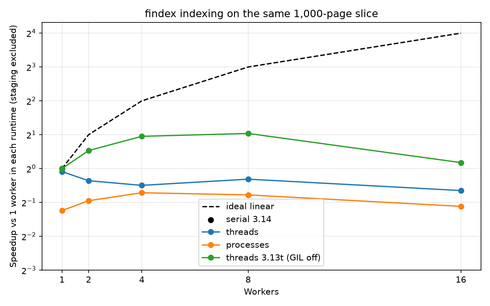

# Findex — Memory-Efficient Search Engine (Lab-01–Lab-05)

[](https://github.com/qlohnx/findex/actions/workflows/ci.yml)

A lightweight, memory-efficient search engine component built in Python to process large XML-based Wikipedia dumps with a minimal RAM footprint.

Python **3.14+** is required, continuing the interpreter version used in Lab 03.
Lab 04 provides an installable `findex` CLI; the earlier `python -m` commands
and the Lab 01–03 results below are retained.
Lab 05 adds local serial, threaded, and process-based index construction.

```bash
uv sync --locked --dev
uv run findex --help
uv run findex index data/ --out data/lab04-index.json --positions --limit 5000
uv run findex search data/lab04-index.json 'python AND (async OR await) NOT java' --k 5
uv run findex search data/lab04-index.json python --scorer tfidf --json
uv run findex stats data/lab04-index.json
```

The corpus can be a `.txt` file, a directory of text files, a `.xml.bz2`
Wikipedia dump, or a directory of dumps. Phrase queries require `--positions`.
Use double quotes around the whole query in PowerShell when convenient.

---

## Project Structure & Architecture

- `src/findex/tokenize.py` — Custom generator-based tokenizer that handles multilingual text, lowercasing, punctuation, and contractions cleanly.

- `src/findex/corpus.py` — Lazy `.txt` document iterator for the Lab 1 corpus intake.

- `src/findex/index.py` — Inverted index data structures for term postings and document metadata.

- `src/findex/search.py` — Boolean search: two-pointer merge (AND/OR/NOT), set-based alternative, benchmark, and CLI.

- `src/findex/store.py` — Save/load of the index in two formats (pickle, json).

- `src/findex/memory_study.py`, `src/findex/format_study.py` — measurements for M4 and M3.

- `src/findex/stats.py` — Lazy (streaming) corpus statistics collector using generators and `xml.etree.ElementTree.iterparse`.

- `src/findex/stats_eager.py` — Eager corpus statistics collector that deliberately loads all documents into lists for performance comparison.

- `src/findex/query.py` — recursive-descent parser and composable query tree.
- `src/findex/ranking.py` — TF-IDF, BM25, timed search, caching, results, and snippets.
- `src/findex/parallel.py` — disk-backed chunks, partial indexes, and ordered merge for three executors.

## Definition of Done Verification

1. **Generators**: Both `iter_documents` and `tokenize` are implemented as Python generators (`yield`), which is programmatically verified via `inspect.isgeneratorfunction()`.

2. **Memory Efficiency**: The `stats` command processes the full corpus on-the-fly without loading the entire XML tree or dataset into RAM.

3. **Tests**: Fully covered by a suite of passing unit tests (`pytest`).

---

## Lab 01 — Corpus and tokenizer

The corpus is the Simple English Wikipedia XML dump stored locally as
`data/simplewiki-latest-pages-articles.xml.bz2`; the corpus is ignored by Git.
Download it from the
[Wikimedia Simple English dumps](https://dumps.wikimedia.org/simplewiki/latest/)
page and place the `.xml.bz2` file in `data/`.
The intake streams one XML page at a time with `iterparse`. The tokenizer
normalizes NFC, applies `casefold()`, and uses `re.finditer(r"\w+(?:['’]\w+)*")`.
Apostrophes stay inside words, hyphens split words, and digits are retained.

## M4: Performance Measurement (Eager vs. Lazy)

We compared the memory-efficient **lazy (generators)** approach against the memory-heavy **eager (lists)** approach on the same corpus slice (500 documents).

| Version | Documents | Peak memory | Elapsed time |
| :--- | :--- | :--- | :--- |
| `eager (lists)` | 500 | 43.62 MB | 1.43 s |
| `lazy (generators)` | 500 | 7.12 MB | 1.65 s |

### Analysis
The performance numbers differ significantly because the eager version loads all raw XML document texts into a single Python list simultaneously and constructs a two-dimensional `list of lists` for tokenized terms. This causes a massive memory spike proportional to the corpus size. 

In contrast, the lazy (streaming) version processes documents one by one using `xml.etree.ElementTree.iterparse` and generators, clearing parsed elements immediately from memory. Consequently, its memory consumption remains minimal and constant, restricted strictly to a single active document and the aggregate frequency `Counter` object.

---

## Usage Instructions

### Running Statistics (Lazy)
```bash
uv run python -m findex.stats data/ --limit 500
```

---

# Lab 02 — The Inverted Index

## Usage

```bash
# M1 + M3: build in one streaming pass and save (.json -> json, anything else -> pickle)
uv run python -m findex.index data/ --out index.bin [--limit 5000] [--positions]

# M2: Boolean query (implicit AND, OR, NOT; evaluated left to right)
uv run python -m findex.search index.bin "python code NOT java" [--engine merge|set]
uv run python -m findex.search index.bin --bench      # merge vs set

# M3 / M4 measurements
uv run python -m findex.format_study data/ --limit 5000
uv run python -m findex.memory_study data/ --limit 5000
uv run python scripts/prove_it.py                    # "prove it to yourself" experiments
```

## Design notes

- `Posting(doc_id, tf, positions=())` and `DocMeta(path, title)` are `@dataclass(frozen=True, slots=True)`, hence hashable.
- Postings are appended while the corpus is streamed with increasing `doc_id`, so every list is sorted by `doc_id`.
- Query semantics: `a b` = `a AND b`, `a NOT b` = `a AND NOT b`, a leading `NOT a` = all documents except `a`. There are no priorities or parentheses (Lab 03).
- `pickle.load` executes arbitrary code from the file, so it is used only for our own index (see the comment in `store.py`). JSON is the safe format.

## M2: merge vs set (AND)

| Case | df | merge, ms | set, ms |
|---|---|---|---|
| common AND common | 3666 / 3884 | 2.470 ms | 0.267 ms |
| rare AND rare | 1 / 1 | 0.001 ms | 0.002 ms |
| common AND rare | 3884 / 1 | 0.001 ms | 0.048 ms |

## M3: formats

| Format | File size | Save time | Load time |
|---|---|---|---|
| pickle | 13.2 MB | 0.76 s | 1.20 s |
| json | 11.4 MB | 1.13 s | 0.67 s |

Positions flag (`--positions`) on the same 1,000-document slice: pickle
`13.2 / 16.6 MB` without/with positions; JSON `11.4 / 17.9 MB`.

## M4: memory study

| Postings representation | Peak memory (build) | Index file size |
|---|---|---|
| `list[Posting]` with plain `@dataclass` | 42.8 MB | 7.1 MB |
| `list[Posting]` with `slots=True` | 32.3 MB | 6.1 MB |
| `array('I')` pairs (doc_ids, tfs) — no objects | 24.5 MB | 5.6 MB |

### Where the bytes went

Measured on 1,000 documents and 345,541 postings:

The plain dataclass stores a per-instance dictionary, so it has the highest
peak memory. `slots=True` removes that dictionary and reduces the per-posting
peak from about 130 B to 98 B. The `array('I')` representation stores integer
pairs without Python posting objects and reduces it to about 74 B per posting.

- **Plain dataclass.** Each posting is a Python object (header + `__dict__`/inline values) plus two `int` objects (28 B each, except small cached ints), plus an 8-byte pointer in the list.
- **`slots=True`.** The per-instance `__dict__` disappears and attributes live in fixed slots, so the object is smaller. Measured on Python 3.13+ the gain is only about 1.4x (`scripts/prove_it.py`, experiment 4), not the 2-3x from older Pythons, because modern CPython already stores instance attributes inline. The ints and the list pointers remain.
- **`array('I')`.** No objects at all: 4 B per `doc_id` plus 4 B per `tf` in two contiguous buffers (8 B per posting). The remaining memory is the dict of terms, the term strings and the 2 arrays per term.
- Note: `Posting` also carries the `positions` field (one extra pointer to the shared empty tuple), which `PlainPosting` in `memory_study.py` does not have.

---

# Lab 03 — Ranking and the Object Model

Lab 03 adds a Pythonic `Index` object, ranked retrieval, and a recursive query
language while preserving the Lab 02 API.

- `Index` implements `Mapping`: `len`, `in`, `[]`, iteration, `repr`,
  `num_docs`, cached `avg_doc_length`, `doc_length`, and `df`.
- `open_index()` is a context manager that closes the loaded index on every
  exit path.
- `TfIdf` and `BM25` share the callable `Scorer` protocol. Results are ranked
  with `heapq.nlargest` and returned as orderable `SearchResult` objects.
- `parse()` builds `Term`, `Phrase`, `And`, `Or`, and `Not` trees. Query nodes
  overload `&`, `|`, and `~`; phrases use positional postings.
- `@timed` uses `functools.wraps`, while `parse()` uses an
  `@lru_cache(maxsize=256)` cache. `parse.cache_info()` exposes cache hits.
- Search results include an ±80-character snippet with matching terms wrapped
  in `**highlight**` markers.

```python
from findex.ranking import BM25, search
from findex.store import open_index

with open_index("index.json") as index:
    for result in search("python AND (async OR await) NOT java", index, BM25(), k=5):
        print(result)
```

## Precision@5 evaluation

## Ranking sanity checks and evidence

The checks are reproducible with `uv run python scripts/ranking_sanity.py
data/index.json`:

```text
rare term: 'aperire' score=8.8242
common term: 'category' score=1.2525
short one-match score=0.1506; long one-match score=0.0449
BM25 tf=1: 0.1051; tf=19: 0.2059; tf=20: 0.2065
20th marginal gain: 0.0006
```

This demonstrates rare-term weighting, BM25 length normalization, and TF
saturation. Repeating a query produces a cache hit and a shorter timing log:

```text
query cache: CacheInfo(hits=0, misses=1, maxsize=256, currsize=1)
search took 38.08 ms
query cache: CacheInfo(hits=1, misses=1, maxsize=256, currsize=1)
search took 0.38 ms
```

The ten queries below use conservative hand-labelled relevance judgments on
the 5,000-document index. For each scorer, precision@5 is
`relevant_in_top_5 / 5`. Reproduce the table with:

```bash
uv run python scripts/evaluate.py data/index.json
```

| Query | Relevant IDs | TF-IDF P@5 | BM25 P@5 |
|---|---|---:|---:|
| `"computer science"` | 71 | 0.20 | 0.20 |
| `"artificial intelligence"` | 2621 | 0.20 | 0.20 |
| `"machine learning"` | 2621 | 0.20 | 0.20 |
| `"world war"` | 1514 | 0.00 | 0.20 |
| `"data compression"` | 1318 | 0.20 | 0.20 |
| `"search engine"` | 467 | 0.20 | 0.20 |
| `"internet explorer"` | 1153 | 0.20 | 0.20 |
| `"linear algebra"` | 286 | 0.20 | 0.20 |
| `"computer program"` | 941 | 0.20 | 0.20 |
| `python` | 1490, 1499, 1504, 2623, 3111 | 1.00 | 0.60 |

---

# Lab 04 — Typing, Testing, Packaging, and CLI

This lab extends the existing tokenizer, streaming corpus intake, inverted
index, Boolean parser, TF-IDF, and BM25. `src/findex/cli.py` is a presentation
layer over those modules.

## M1 — Types

All public functions and methods under `src/findex` have annotations.
`uv run pyright` checks the entire package in **strict** mode. `Scorer` is a
structural `Protocol`: `BM25` and `TfIdf` satisfy its callable signature without
inheriting it. `Iterable` accepts streaming input; generators return `Iterator`
(context managers use `Generator`). `@timed` uses PEP 695 `**P, R` generics to
preserve argument and return types. Engine and scorer options use `Literal`;
statistics and JSON result rows use `TypedDict`.

There are no `# type: ignore` suppressions. The single `cast` in JSON loading
documents the stdlib's untyped boundary; each field is validated before entering
the typed index. The memory-study variants retain their original plain/slotted/
array representations in separately typed storage.

## M2 — Tests and coverage

```bash
uv run --locked pytest --cov=findex --cov-report=term-missing --durations=10
uv run --locked pytest -m "not slow"
uv run --locked ruff check .
uv run --locked ruff format --check .
uv run --locked pyright
```

`tests/conftest.py` supplies a tiny multilingual corpus, a fresh positional
index per test, text files, and a compressed XML fixture. Tests require no
downloaded corpus or network. Existing Lab 01–03 tests remain part of the suite.
Unicode tokenizer examples are parametrized. Ranking checks cover rare-term
weighting for both scorers, BM25 length normalization and saturation, and
TF-IDF's diminishing TF weight. `CliRunner` tests help, indexing, both scorers,
statistics, JSON Lines, logging levels, and expected errors.

Five Hypothesis properties check:

1. Tokens are never empty, including arbitrary Unicode input.
2. Tokenization is idempotent after joining its tokens.
3. AND/OR/NOT merges of sorted unique document IDs agree with Python sets.
4. JSON/pickle round trips preserve postings, positions, metadata, lengths, and text.
5. Query trees render and parse back to equal trees, including nested parentheses.

Serialization properties and memory measurements are marked `slow`.
Local validation on Python 3.14.7: **107 tests passed**, including **5 Hypothesis
properties**; **79% coverage** across the whole package (882/1,111 statements),
**97%** for the CLI, and **100%** for the tokenizer and text-corpus intake.
Strict pyright reports **0 errors**, and both Ruff checks pass.
Coverage includes the whole package, including the older standalone experiment
commands. Uncovered paths mainly belong to their `argparse` entry points and
printed benchmark reports; they are retained for reproducing earlier labs.
The wheel smoke check separately exercises the installed command in fresh
tool directories; it passed for help, indexing, statistics, and both scorers.
The new CLI also successfully searched the existing Lab 03 `data/index.json`.

The final audit added regression tests for overlapping snippet highlights,
Windows `cp1251` output in the memory-study command, and inconsistent JSON
indexes. JSON loading now rejects nonpositive term frequencies, duplicate or
unsorted postings, mismatched document metadata, and invalid positions before
statistics or ranking can consume them.

| Requirement | Verification | Status |
|---|---|---|
| M1: full typing and strict pyright | All function signatures annotated; pyright: 0 errors; Ruff checks pass | Passed locally |
| M2: at least 30 tests and 3 properties | 107 passing tests; 5 Hypothesis properties; fixtures, CLI tests, slow markers, and coverage report | Passed locally |
| M3: installed CLI and wheel | Isolated source and wheel installs; index/search/stats; BM25/TF-IDF; JSON piping and logging | Passed locally |
| M4: logging, CI, and tags | Logging configured in CLI; CI passed on Ubuntu and Windows; release tags pushed | Passed |
| M4: published release | Wheel and source archive attached to v0.4.0; public URL installation and help verified in a fresh tool environment | Passed |

## M3 — Installed CLI and wheel

```bash
# Install the current source as a command:
uv tool install .
findex --help

# Build both wheel and source distribution, then install the wheel:
uv build
uv tool install dist/findex-0.4.0-py3-none-any.whl

# Verify an isolated wheel install outside the repository:
uv run python scripts/check_wheel.py dist/findex-0.4.0-py3-none-any.whl
```

The smoke script uses temporary `UV_TOOL_DIR` and `UV_TOOL_BIN_DIR`, removes
`PYTHONPATH`, and runs help, indexing, statistics, and both scorers from outside
the repository. It does not change the user's installed tools or PATH.
`[project.scripts]` creates the `findex` executable; `py.typed` ships in the
wheel. Pytest has no `pythonpath = ["src"]` workaround: `uv sync` installs the
package before tests run. `uv.lock` fixes dependency versions for reproducibility.

```bash
findex index corpus/ --out index.json --positions --limit 100
findex search index.json '"search engine" OR python' --k 10 --scorer bm25
findex -v search index.json python --json
findex -vv search index.json python --json
findex stats index.json
```

Rich renders result tables, highlighted snippets, statistics, and a progress bar
when indexing in a terminal. `--json` emits one object per line to stdout;
no matches emit no lines. Each object has `doc_id`, `score`, `title`, and
`snippet` (using the Lab 03 `**highlight**` markers).

## M4 — Logging, CI, and release

CLI output goes to stdout; progress and diagnostics go to stderr.
`-v` enables INFO; `-vv` enables DEBUG, including `@timed` and parser cache
statistics. Library modules use named loggers and lazy `%` formatting; only
the CLI configures handlers. Missing files, malformed indexes, invalid query
syntax, and phrase queries without positions produce a one-line error and a
nonzero exit code. Typer validates CLI options before running commands.

`.github/workflows/ci.yml` checks lint, formatting, strict types, tests with
coverage, package builds, and isolated wheel installation on Ubuntu and Windows
using Python 3.14. Distribution artifacts and coverage XML are uploaded by CI.
The release commit passed [CI on Ubuntu and Windows](https://github.com/qlohnx/findex/actions/runs/41700115674).
The badge tracks the latest GitHub run for `lab-04`.

**Published:** [findex v0.4.0](https://github.com/qlohnx/findex/releases/tag/v0.4.0)
contains the wheel and source archive. The public wheel's SHA-256 was checked
against the local artifact, and installation from its release URL followed by
`findex --help` passed in a fresh tool environment outside the repository.
The release was published through the GitHub API after both CI jobs passed;
the tag-conditioned release job was skipped in the initial push.

The pushed tags `lab-04` and `v0.4.0` identify the same validated release commit.
Later documentation commits on `lab-04` leave those release tags in place.
Inspect their commit IDs with:

```bash
git rev-parse refs/tags/lab-04 refs/tags/v0.4.0
```

Install the published release in another environment:

```bash
uv tool install https://github.com/qlohnx/findex/releases/download/v0.4.0/findex-0.4.0-py3-none-any.whl
findex --help
```

## Reflection

1. CPython stores annotations; pyright checks them before execution, IDEs use
   them for navigation and completion, and Typer reads them to generate the CLI.
2. Narrowing: after `if value is None: return ""`, a `str | None` value is a
   `str`, so calling `value.upper()` is safe.
3. Accept `Iterable[T]` to allow lists and streams; return `Iterator[T]` when
   callers may use `next()`.
4. A Protocol describes required methods. Matching `__call__` parameter and
   return types makes a scorer compatible without explicit inheritance.
5. Session fixtures are shared for the entire run. Mutating a shared index
   changes later tests; the mutable index fixture here has function scope.
6. Merge/set agreement is a property over arbitrary document-ID sets.
   Hypothesis shrinks failures to a small counterexample that is easy to debug.
7. The `src/` layout prevents accidental imports directly from the repository
   root from hiding a broken installation.
8. An entry point creates an executable wrapper (`findex.exe` on Windows)
   that imports and calls `findex.cli:app`.
9. Logging with `%` arguments defers message formatting until the selected
   level is enabled; an f-string is formatted before calling the logger.

---

# Lab 05 — Concurrency and the GIL

`findex index` now accepts `--executor serial|threads|processes` and
`--workers N`. The default remains **serial**: on the measured corpus slice it
was faster than both ordinary threaded and process-based builds. The old
`build_index(pages)` API is retained. The installed CLI streams XML/text pages
into bounded temporary chunk files (256 documents each), assigning global
document IDs before starting workers. `build_partial` reads chunk **paths** and
constructs postings; `merge` consumes partials in original order. It preserves
document IDs, sorted postings, term insertion order, metadata, positions, and
snippets. The three executors write byte-identical JSON and pickle files in
tests; JSON bytes also match the Lab 04 implementation. Pickle bytes need not
match Lab 04 because pickle memoizes object identity, but loaded values do.
Temporary chunks are deleted on success or failure. Process workers use the
`spawn` context and module-level functions; worker exceptions propagate.
Local validation: **119 tests passed**, including six byte-equality tests also
run under free-threaded 3.13t; whole-package coverage is **81%** and the new
parallel module is **99%** covered. Strict pyright reports 0 errors, and Ruff
lint and format checks pass. A freshly built wheel was also installed outside
the repository; its serial and process CLI builds wrote identical indexes,
and help, statistics, and both scorers worked.

```bash
uv run findex index data/simplewiki-latest-pages-articles.xml.bz2 \
  --out data/parallel-index.json --positions --limit 1000 \
  --executor processes --workers 4
uv run findex search data/parallel-index.json '"computer science"' --k 5
```

## Measurements

Run the reproducible experiments with:

```bash
uv run --locked python scripts/benchmark_parallel.py \
  data/simplewiki-latest-pages-articles.xml.bz2 --limit 1000 \
  --chunk-size 64 --runs 3 --warmups 1 --workers 1 2 4 8 16
uv run --no-project --python 3.13t --with psutil python \
  scripts/benchmark_free_threaded.py \
  data/simplewiki-latest-pages-articles.xml.bz2 --limit 1000 \
  --chunk-size 64 --runs 3 --warmups 1 --workers 1 2 4 8 16
uv run --locked python scripts/plot_lab05.py
```

Machine: Intel Core i5-12500H, 12 physical / 16 logical cores, 16 GB RAM,
Windows 11. Normal runs used CPython 3.14.7 with the GIL; free-threaded runs
used CPython 3.13.15t with `sys._is_gil_enabled() == False`. Project packaging
still requires Python 3.14+, so the 3.13t experiment imports only the
stdlib-based index modules directly from `src/` in an isolated `uv --no-project`
run. The same first 1,000 Wikipedia pages (66,170 distinct terms) were staged
into 16 files of at most 64 documents. Staging took 0.76 s on 3.14 and 0.60 s
on 3.13t; it is **excluded** from the table's wall/CPU/RSS values. Add it for end-to-end
time. Each configuration ran one warmup and three measured repetitions.
Numbers are medians; raw repetitions and spread are in
[`benchmarks/lab05.json`](benchmarks/lab05.json) and
[`benchmarks/lab05-3.13t.json`](benchmarks/lab05-3.13t.json).
CPU is parent `process_time` plus worker CPU for processes; for threads,
parent CPU already includes all threads. RSS is the sampled **parent-process**
peak, not the total of process workers. Merge time is measured separately
during ordered reduction and may overlap worker execution for threads.
All configurations produced the same document and term counts. Speedup uses
serial 3.14 for 3.14 rows and one-thread 3.13t for 3.13t rows; this isolates
scaling from interpreter differences and changing background load. The normal
threaded runs varied notably (up to 0.95 s spread at two workers), so these
numbers are not precise hardware rankings.

| Executor | Workers | Wall, s | CPU, s | Parent RSS, MB | Merge, s | Speedup |
|---|---:|---:|---:|---:|---:|---:|
| serial 3.14 | 1 | 1.836 | 1.672 | 141.9 | 0.087 | 1.00× |
| threads 3.14 | 1 | 1.951 | 1.859 | 143.5 | 0.144 | 0.94× |
| threads 3.14 | 2 | 2.353 | 2.281 | 144.3 | 0.213 | 0.78× |
| threads 3.14 | 4 | 2.587 | 2.406 | 145.9 | 0.569 | 0.71× |
| threads 3.14 | 8 | 2.279 | 2.141 | 151.5 | 0.298 | 0.81× |
| threads 3.14 | 16 | 2.877 | 2.719 | 155.7 | 0.934 | 0.64× |
| processes 3.14 | 1 | 4.338 | 4.266 | 163.1 | 0.214 | 0.42× |
| processes 3.14 | 2 | 3.542 | 3.922 | 164.1 | 0.217 | 0.52× |
| processes 3.14 | 4 | 3.010 | 3.328 | 164.9 | 0.436 | 0.61× |
| processes 3.14 | 8 | 3.144 | 3.609 | 164.4 | 0.126 | 0.58× |
| processes 3.14 | 16 | 3.977 | 4.297 | 166.3 | 0.127 | 0.46× |
| threads 3.13t | 1 | 1.080 | 1.125 | 158.5 | 0.105 | 1.00× |
| threads 3.13t | 2 | 0.747 | 1.359 | 192.6 | 0.119 | 1.45× |
| threads 3.13t | 4 | 0.558 | 1.641 | 219.8 | 0.200 | 1.94× |
| threads 3.13t | 8 | 0.526 | 2.234 | 252.3 | 0.205 | 2.05× |
| threads 3.13t | 16 | 0.955 | 4.312 | 295.5 | 0.098 | 1.13× |



## What the measurements mean

Concurrency means scheduling multiple tasks; parallelism means executing
several simultaneously. Indexing spends most of its build time tokenizing
strings and updating Python dictionaries, so it is substantially CPU-bound.
With the GIL in ordinary CPython 3.14, only one thread at a time executes
Python bytecode. Other threads can run while one waits for disk I/O, but these
chunks spend too little time waiting to recover the thread scheduling and
merge overhead. More threads therefore do not improve wall time here. The
GIL protects interpreter internals, not application invariants: a shared
`Counter` would still need synchronization. Our workers instead construct
independent partial indexes; only the parent mutates the final index. That
design also avoided a race in the 3.13t run. No race was observed, so no
race-condition fix was necessary.

Processes have separate interpreters and GILs, so they *can* run CPU work on
multiple cores. They are not automatically faster. Windows `spawn` starts
fresh interpreters; workers unpickle their tasks, read chunk files, and pickle
partial indexes back. The parent then merges postings and metadata in document
order. On only 1,000 pages, process creation, serialization, data transfer,
and merge exceed the CPU time that parallelism saves. Even two processes took
3.542 s versus 1.836 s serial. Parent RSS understates their actual total
memory because child RSS is excluded. Sending paths instead of already-loaded
documents avoids an additional input-copy cost, but the result still includes
document texts required for search snippets. This is why `processes` is an
option, not the default, until a larger-corpus measurement demonstrates a win.

Without the GIL, the same independent partial-builder code runs Python work
on multiple cores. Eight 3.13t threads reduced indexing wall time from that
runtime's 1.080 s one-thread baseline to 0.526 s (2.05×). CPU rose from
1.125 to 2.234 s because work really overlapped across cores and incurred
coordination costs. Sixteen threads regressed to 0.955 s: more concurrency
increased memory, scheduling, and merge pressure. This is a measured result,
not an assumed linear speedup. Cross-interpreter absolute times need caution:
ordinary serial runs varied from 1.17 to 1.84 s across sessions as load changed.

Amdahl's law limits the complete pipeline. Within the 3.13t run, chunk staging
was serial and cost 0.60 s; one-thread indexing cost 1.080 s. Even if indexing
were infinitely fast, the end-to-end speedup would be at most
`(0.60 + 1.080) / 0.60 ≈ 2.8×` before serialization or output costs. The
measured eight-thread path was `(0.60 + 1.080) / (0.60 + 0.526) ≈ 1.49×`
end-to-end, excluding final save time. Ordered merge remains sequential and
becomes a larger fraction as workers speed up; at eight 3.13t threads it took
0.205 s. An I/O-bound crawler
or network fetcher is a different workload: ordinary threads can overlap
waiting there without needing a GIL-free interpreter.

**Scope of evidence:** This table is a 1,000-page slice, *not* the lab's
requested full-corpus benchmark. The source dump is 356 MB compressed; only
about 1.8 GB of physical RAM was free while measuring. Running the entire dump
with 16 process workers and an in-memory final index was not safe on this
machine. The benchmark scripts accept a larger `--limit` or no limit for a
machine with sufficient RAM. Consequently the full-corpus performance claim
and any process-default decision remain open.
